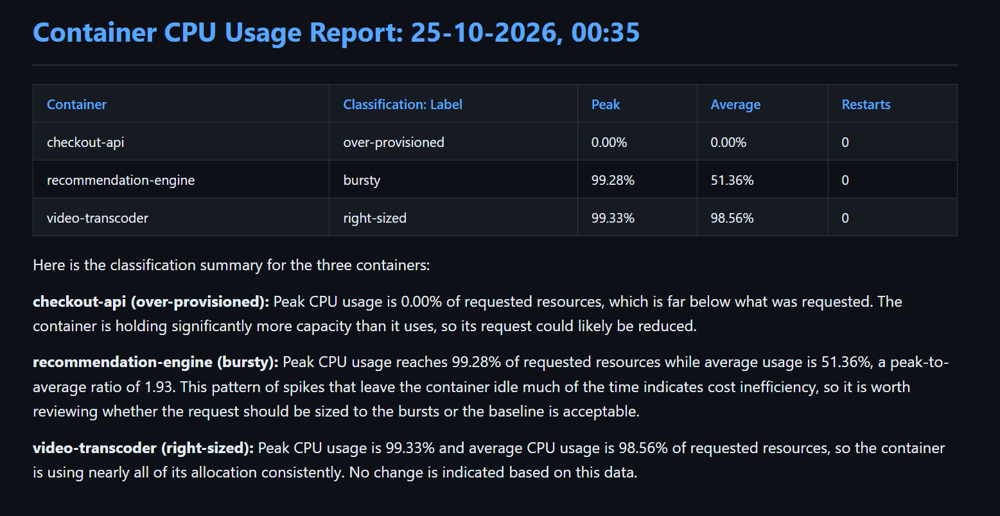
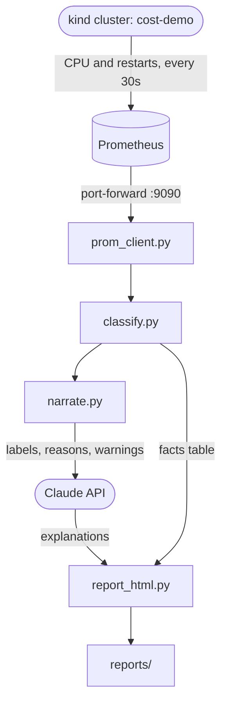

# Streaming Cost Anomaly Detector

## Overview

Due to poor CPU sizing, streaming platforms waste money in Kubernetes when their containers are over-provisioned or risk performance when containers are under-provisioned. It goes unnoticed because nothing alerts on waste, only failures. This tool pulls CPU metrics from Prometheus and classifies each container's CPU sizing using fixed rules, while Claude explains each result in plain English. The output is an HTML report with a facts table plus a short explanation per container which the SRE team can scan in under a minute.

## Sample Output

`checkout-api` is over-provisioned, `recommendation-engine` is bursty and `video-transcoder` is right-sized. My code builds the table and decides the labels, and Claude only writes the explanations from labels, reasons, and restart warnings.

## How It Works

`report_html.py` has two inputs on purpose: `classify.py` decides the labels and `report_html.py` builds the table, so every number in the table comes from my code. Claude only writes explanations, so even if it gets something wrong, the values in the table stay correct.

## Tech Stack

| Technology | Purpose |
|---|---|
| Kubernetes (`kind`) | Runs a single-node local cluster with three demo workloads in the `cost-demo` namespace |
| Docker | Runs the kind cluster as a container |
| Helm | Installs Prometheus into the `kind` cluster via the `kube-prometheus-stack` chart |
| Prometheus | Scrapes CPU and restart metrics from `kind` |
| Python `3.12` | Runs the anomaly detector tool |
| Claude API | Uses Haiku 5.5 as the model to easily explain the classifications for each container after the classifier already made the decisions |
| markdown | Converts Claude’s written explanation into HTML for the report |
| pytest | Tests the classification rules, missing data, and prompt slimming without requiring a cluster or API key |

## How To Run It

## Key Decisions

## What I'd Do Differently/Next 